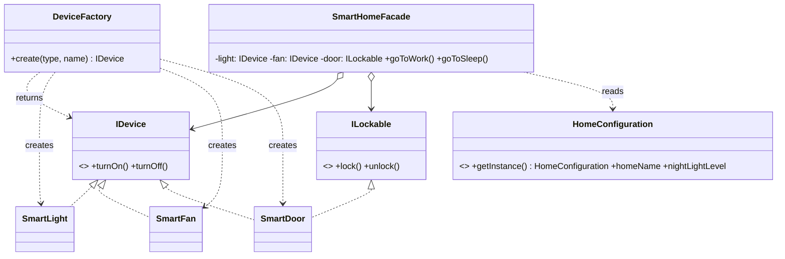

# Smart Home Mini (Java) - Factory, Singleton, Facade

## Chay chuong trinh
```bash
javac -d out src/smarthome/*.java test/smarthome/*.java
java -cp out smarthome.Main            # demo
java -cp out smarthome.SmartHomeTests  # kiem thu T1-T5
```
Yeu cau: JDK 17+ (dung switch expression).

## So do lop (Mermaid)


## Vi tri su dung pattern
- **Factory**: `DeviceFactory.create(type, name)` - client khong goi constructor cua tung thiet bi.
- **Singleton**: `HomeConfiguration` - `homeName`, `nightLightLevel` dung chung toan ung dung.
- **Facade**: `SmartHomeFacade` - `goToWork()`, `goToSleep()` gom nhieu thao tac thiet bi.

## Loi ich
- Client phu thuoc abstraction (`IDevice`, `ILockable`), khong phu thuoc lop cu the.
- Cau hinh chi co mot the hien; che do duoc kich hoat bang mot lenh.
- `Lock()` chi nam o `ILockable` nen den/quat khong bi ep cai dat thao tac vo nghia.

## Mot han che
Them loai thiet bi moi (vi du `SmartCamera`) van phai sua `switch` trong `DeviceFactory`;
ngoai ra `SmartHomeFacade` doc `HomeConfiguration.getInstance()` truc tiep nen la phu thuoc an, kho thay bang doi tuong gia khi test.

## Ghi chu thiet ke
- `SmartDoor` cai ca `IDevice` (bat/tat he thong dien tu cua) va `ILockable` (khoa/mo khoa) theo yeu cau de bai.
- `ArgumentException` cua C# duoc thay bang `IllegalArgumentException` trong Java.
- Khong dung lop co so chi de tai su dung vai dong `println`.

## Ket qua kiem thu
T1-T5 deu PASS (xem `SmartHomeTests`).

## Tra loi cau hoi Phan G
1. **Factory che giau quyet dinh thiet ke nao?** Quyet dinh tao lop cu the nao (`SmartLight`/`SmartFan`/`SmartDoor`) va cach khoi tao no; client chi biet chuoi loai va nhan lai `IDevice`.
2. **Singleton bao dam gi, rui ro gi?** Bao dam chi co mot the hien va mot diem truy cap toan cuc. Rui ro: trang thai toan cuc, phu thuoc an, kho unit test (cac test anh huong lan nhau, kho mock), de gan chat cac thanh phan.
3. **Facade khac Factory the nao?** Factory nham *tao doi tuong* (che giau viec khoi tao); Facade nham *don gian hoa viec su dung* mot nhom doi tuong co san bang giao dien muc cao.
4. **Bo SmartHomeFacade thi client phai biet them gi?** Che do nao tac dong thiet bi nao, thu tu goi cac thao tac, thao tac nao ap dung cho thiet bi nao (cua can `lock()`), va tu doc `nightLightLevel` tu `HomeConfiguration` roi thong bao.
